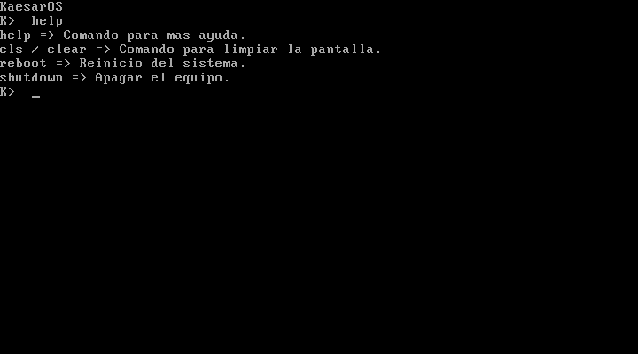

# KaesarOS

Un sistema operativo de consola hecho desde cero, para aprender cómo funciona un ordenador por dentro.

Sin Linux, sin librerías, sin nada debajo: solo la CPU, la BIOS y código escrito a mano en ensamblador x86.

## Qué hace ahora

- Arranca con la BIOS desde un sector de 512 bytes, que carga el kernel desde el disco.
- Muestra el logo durante 1 segundo.
- Abre una consola (`K>`) con borrar y límite de 60 caracteres.
- Comandos: `help`, `cls`, `clear`, `reboot` y `shutdown`.

## Licencia

[MIT](LICENSE)
